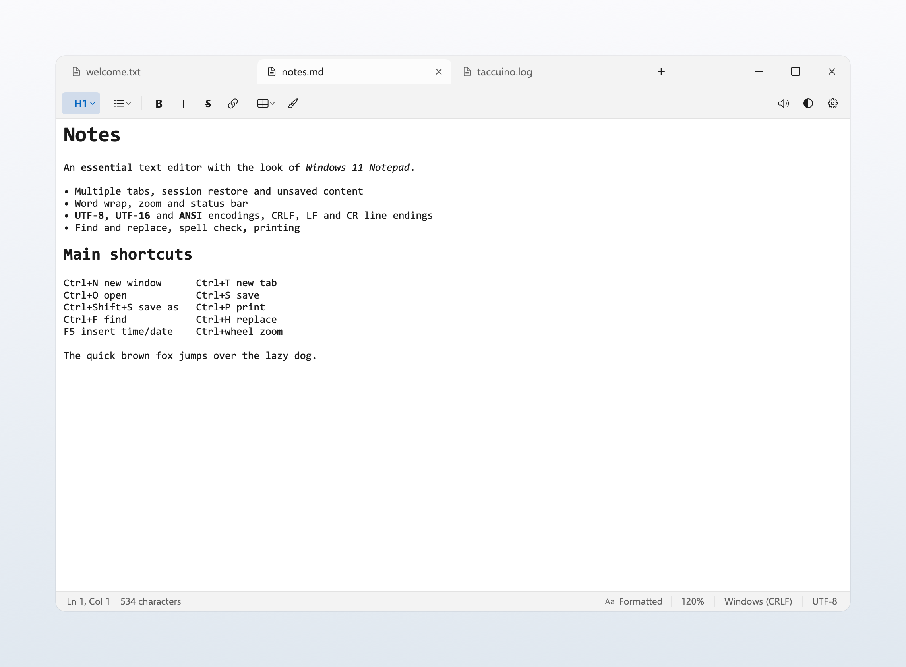
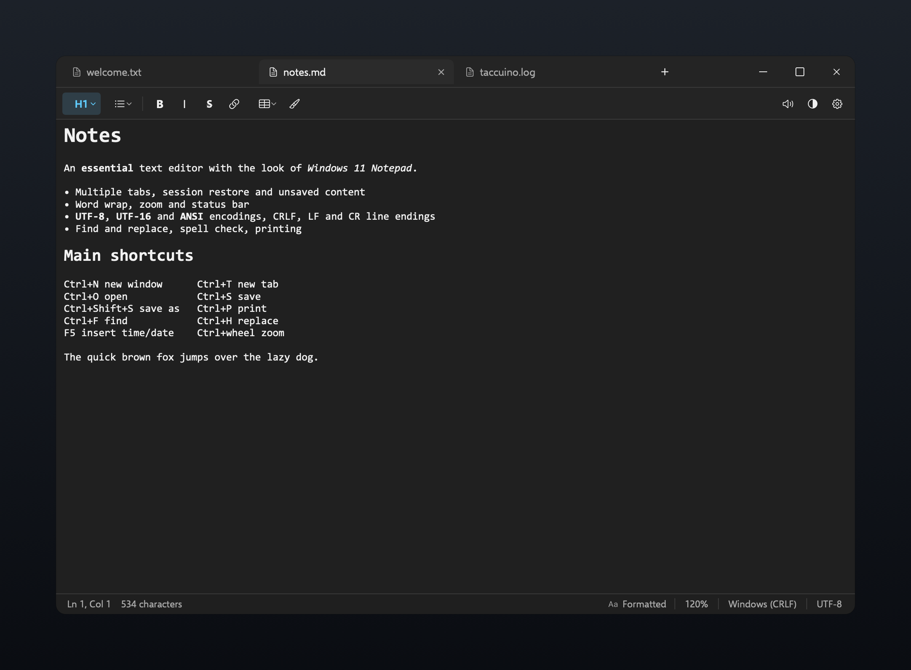
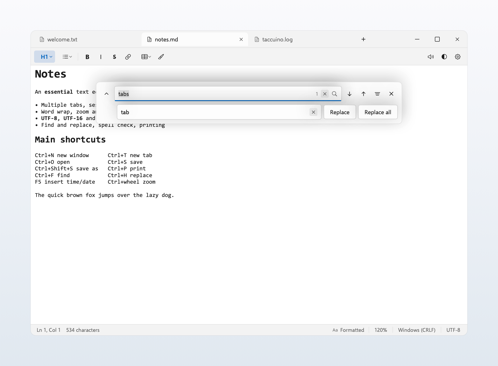
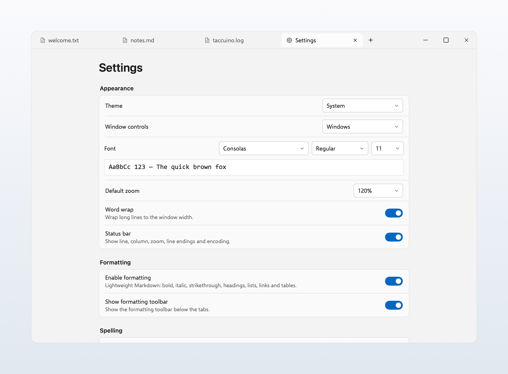
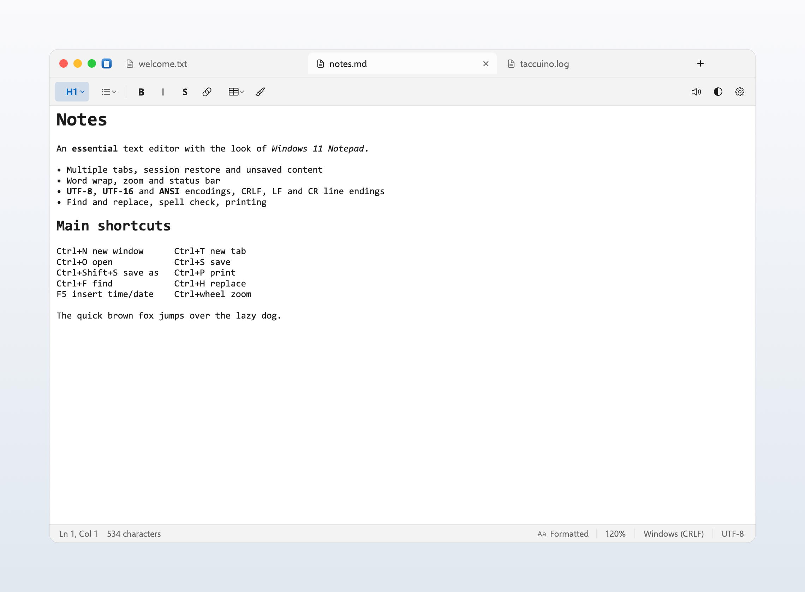
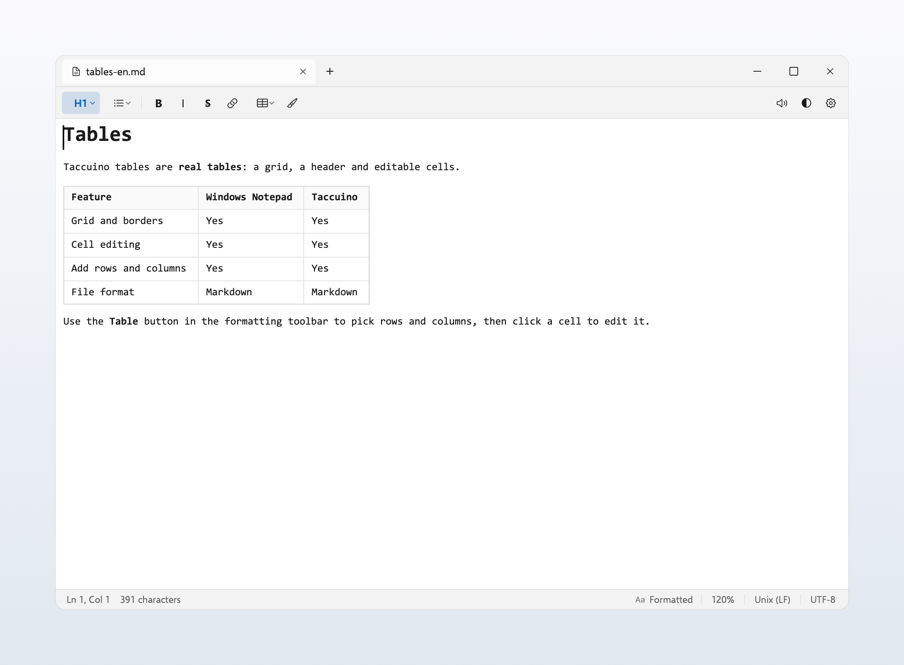
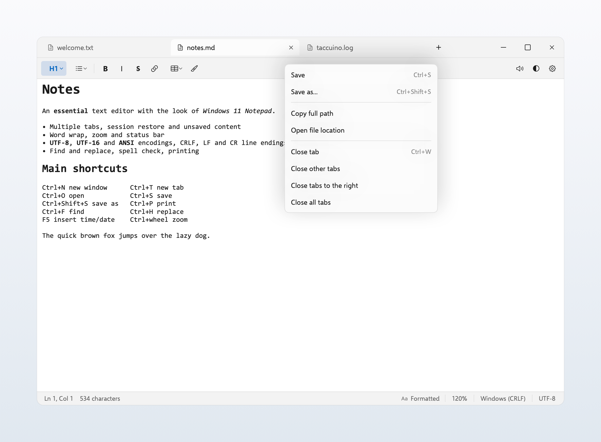

# Taccuino

A native macOS text editor that recreates the **Windows 11 Notepad** experience: tabs, status bar, find & replace, Windows encodings, Markdown formatting, real tables and session restore. The UI follows Windows 11 / Fluent design, with **Windows 11 window controls** by default and optional macOS traffic lights. Commands live in the macOS menu bar; the window contains only the tab strip, formatting toolbar, editor and status bar. The interface is available in English and Italian, following the macOS language.

> Independent project, not affiliated with Microsoft. “Notepad” and “Windows” are trademarks of Microsoft Corporation. The code, the Taccuino name and the app icon are original. Bundled fonts (Selawik, Cascadia Mono) are distributed under the SIL OFL 1.1 license; Consolas is not bundled.



| Dark theme | Find & replace |
|---|---|
|  |  |

| Settings | macOS window controls (optional) |
|---|---|
|  |  |



*Real tables: grid, header and editable cells, saved as Markdown.*



*Tab context menu.*

## Features

- **Faithful Windows 11 look**: tabs integrated into the title bar, status bar and a translucent **Mica-like** surface in light and dark themes with Fluent blue accents. Window controls are the **Windows 11** minimize/maximize/close buttons by default; macOS traffic lights are available in *Settings › Appearance › Window controls*.
- **No in-window menu bar**: File, Edit, View, Format, Window and Settings are in the macOS menu bar. The window only contains tabs, the formatting toolbar, the editor and the status bar.
- **Markdown formatting**: toolbar below the tabs with normal text and headings (H1–H3), bulleted/numbered lists with indentation, bold, italic, strikethrough, links, tables and clear formatting. With no selection, bold/italic/strikethrough format the word at the cursor; on empty text or whitespace they do nothing instead of inserting stray `****` or `~~~~` markers. A dedicated **Format** menu in the macOS menu bar mirrors the toolbar. The toolbar can be shown or hidden from *View* and Settings. If you disable formatting, you can re-enable it from *View › Enable formatting*, *Format › Enable formatting* or Settings. Switch between **Formatted** and **Markdown** views from the Format menu or the status-bar button. Formatting is stored as Markdown and can be disabled in Settings.
- **Real tables**: Markdown tables are rendered as a Windows 11-style grid with a header, borders and editable cells. The **Table** button opens an 8×8 grid picker for rows and columns. Click to select a cell, double-click (or start typing) to edit it, drag or Shift-click to select a rectangular range, use the arrow keys to move and Shift+arrows to extend the selection. `⌘C`, `⌘X`, `⌘V` and Delete work on ranges: copy/cut as tab-separated text, paste TSV data (adding rows/columns when needed) and clear cell contents. Bold, italic, strikethrough and clear formatting apply to the selected cells. **Format › Table**, the table context menu and the picker let you add rows/columns above, below, left or right and delete them. Files remain standard Markdown tables.
- **Toolbar utilities**: read the document or selection aloud, switch theme, and open Settings directly from the right side of the formatting toolbar.
- **Multiple tabs**: new tab, close, drag to reorder, unsaved indicator and a Settings tab. **Middle-click a tab to close it**; right-click opens the tab menu with save, copy path, reveal in Finder and close others/to the right.
- **Notepad-style session restore**: at launch, all windows, tabs, cursors, scroll positions and unsaved contents are restored. With the option enabled, closing the window or the last tab **does not prompt to save**: the app quits and the note is there on the next launch. The session is stored in `~/Library/Application Support/Taccuino/session.json`.
- **Automatic external reload**: while a file is open, Taccuino checks it on disk every 1.5 seconds. If another app or a sync client changes it and the note has no local edits, the editor reloads silently; if you have unsaved changes, Taccuino asks whether to reload the disk version or keep your edits.
- **Multiple windows** (`Ctrl/⌘+N`) with full session restore.
- **Native text editor** (NSTextView): per-tab undo/redo, selection, text dragging, plain-text paste, 8-character tab stops, continuous spell checking and optional autocorrect.
- **Word wrap** from the View menu or Settings; when disabled, horizontal scrolling is available.
- **Zoom** from 10% to 500% with `Ctrl/⌘ +`, `Ctrl/⌘ -`, `Ctrl/⌘ 0`, `Ctrl`+wheel and pinch. Settings also offers a **default zoom** (50%–500%).
- **Fonts**: family, style (regular, bold, italic, bold italic) and size, with a live preview. The default is **Consolas Regular 11**, exactly like Notepad. Taccuino does not redistribute Consolas: if installed (for example with Microsoft Office) it loads it from the system; otherwise it uses the bundled **Cascadia Mono 11**. The UI uses **Selawik**, metrically compatible with Segoe UI.
- **Find & replace** in a floating Windows 11-style panel: match case, whole word, match count, wrap-around search, previous/next, replace and replace all. Shortcuts: `Ctrl/⌘+F`, `Ctrl/⌘+H`, `F3`, `Shift+F3`, `⌘G`, `⇧⌘G`, `Esc`.
- **Windows encodings**: detection and saving for UTF-8, UTF-8 with BOM, UTF-16 LE, UTF-16 BE and ANSI (Windows-1252). BOM detection and heuristic analysis for UTF-16 files without a BOM, like Notepad.
- **Line endings**: Windows (CRLF), Unix (LF), Classic Mac (CR), with automatic detection and conversion on save. The Save As panel includes **Encoding** and **Line ending** selectors.
- **Status bar**: line and column, character count, Formatted/Markdown state, zoom, line ending and encoding. Can be shown or hidden.
- **Native Open/Save**: macOS panels, multiple-file open, recent files, drag files into the window, and a confirmation for characters that cannot be represented in ANSI.
- **Notepad features**: insert time/date with `F5`, automatic timestamp for files starting with `.LOG`, page setup and printing (on white pages, even in dark mode). With session restore enabled, closing the window or the last tab shows no dialog; a single modified tab only prompts when other tabs remain open.
- **Themes**: System, Light, Dark. The theme follows macOS appearance changes while the app is open.
- **Formatting settings**: enable/disable formatting and the toolbar below the tabs; choices are persistent. The default zoom is configured in Settings. Autocorrect can also be toggled from *Edit › Spelling › Autocorrect*.
- **Bilingual**: English and Italian, following the macOS language. You can set the language for the app only in *System Settings › General › Language & Region › Applications*.
- **Aligned window**: Windows 11 caption buttons by default (or optional macOS traffic lights), drawn and centered, draggable tab strip, double-click to zoom and full screen from the menu.
- **No telemetry**, no servers, no network access.

## Requirements

- macOS 15 or later.
- Swift 6 / Command Line Tools (Xcode not required).
- With Command Line Tools only, the build script automatically uses SDK 26.5: SDK 27 requires the SwiftUI macro plugin included with Xcode.
- Consolas is optional. If not installed, Taccuino uses the bundled Cascadia Mono. Selawik and Cascadia Mono are included under the SIL OFL 1.1 license. Consolas is never redistributed.

## Build and run

```bash
cd Taccuino
./scripts/build-app.sh          # release → dist/Taccuino.app
./scripts/build-app.sh debug    # debug
open dist/Taccuino.app
```

Or:

```bash
make build
make run
```

The app is ad-hoc signed: distributing it to other Macs requires a Developer ID signature and notarization. It is not sandboxed, so it can freely open and save files chosen by the user.

### Self-test

```bash
./dist/Taccuino.app/Contents/MacOS/Taccuino --selftest
```

Runs tests for encoding/decoding, line-ending detection, line/column, session serialization, Markdown formatting, table parsing and editing, insertion, search, replace and undo.

## Shortcuts

Windows-style (`Ctrl`) and macOS (`⌘`) shortcuts both work.

| Action | Key |
|---|---|
| New tab | `Ctrl+T` / `⌘T` |
| New window | `Ctrl+N` / `⌘N` |
| Open | `Ctrl+O` / `⌘O` |
| Save / Save As | `Ctrl+S` / `⌘S` · `Ctrl+Shift+S` / `⇧⌘S` |
| Print | `Ctrl+P` / `⌘P` |
| Close tab | `Ctrl+W` / `⌘W` |
| Close window | `Ctrl+Shift+W` / `⇧⌘W` |
| Find / Replace | `Ctrl+F` / `⌘F` · `Ctrl+H` / `⌥⌘F` |
| Find next / previous | `F3` / `⇧F3` · `⌘G` / `⇧⌘G` |
| Undo / Redo | `Ctrl+Z` / `⌘Z` · `Ctrl+Y` / `⇧⌘Z` |
| Cut, copy, paste | `Ctrl+X/C/V` / `⌘X/C/V` |
| Select all | `Ctrl+A` / `⌘A` |
| Bold / italic / strikethrough | `Ctrl+B` / `⌘B` · `Ctrl+I` / `⌘I` · `Ctrl+Shift+X` / `⇧⌘X` |
| Headings 1/2/3 / normal text | `Ctrl+Opt+1/2/3/0` · `⌘⌥1/2/3/0` |
| Bulleted / numbered list | `Ctrl+Shift+8/7` · `⇧⌘8/7` |
| Indent list | `Ctrl+]` / `⌘]` · `Ctrl+[` / `⌘[` |
| Link | `Ctrl+K` / `⌘K` |
| Markdown view | `Ctrl+Shift+M` / `⇧⌘M` |
| Show/hide formatting toolbar | `⌘⌥T` |
| Zoom in / out / reset | `Ctrl/⌘ +`, `Ctrl/⌘ -`, `Ctrl/⌘ 0` |
| Switch tab | `Ctrl+Tab` / `Ctrl+Shift+Tab`, `Ctrl+PgUp/PgDown` |
| Insert time/date | `F5` |
| Settings | `Ctrl+,` / `⌘,` |
| Start/end of line | `Home` / `End` |
| Start/end of document | `Ctrl+Home` / `Ctrl+End` |
| Previous/next word | `Ctrl+←` / `Ctrl+→` |
| Delete word | `Ctrl+Backspace` / `Ctrl+Delete` |

On Mac keyboards without dedicated function keys, use `Fn` for `F3` and `F5`.

## Project structure

```
Sources/Taccuino/
├── main.swift
├── AppDelegate.swift           # App lifecycle, macOS menus, shortcuts, session
├── Models/
│   ├── Document.swift          # Text, encoding, line endings, modified state
│   ├── SettingsStore.swift     # Persistent preferences
│   └── WindowModel.swift       # Tabs, context menus, find & replace
├── Services/
│   ├── TextFile.swift          # File I/O and encoding detection
│   ├── EditorController.swift  # NSTextView, undo, search, printing
│   ├── MarkdownFormatting.swift # Markdown parser and renderer
│   ├── SessionStore.swift      # Session persistence
│   └── SelfTest.swift
├── Support/
│   ├── Localization.swift
│   ├── FontLoader.swift        # Selawik/Cascadia/Consolas registration
│   └── Theme.swift             # Fluent light/dark palette
└── Views/
    ├── WindowController.swift  # Window, native panels, saving
    ├── RootView.swift          # Layout, status bar, editor host
    ├── TabBarView.swift
    ├── FormattingToolbarView.swift
    ├── TableOverlayView.swift  # Table grid and cell editing
    ├── TablePickerView.swift   # Table size picker
    ├── WindowChrome.swift      # macOS and Windows 11 controls
    ├── MicaBackground.swift
    ├── PopupMenuView.swift     # Fluent context menus
    ├── FindBarView.swift
    ├── SettingsView.swift
    └── Components.swift
```

## Notes and limitations

- **macOS adaptations**: Open/Save panels are native macOS panels. Window buttons are drawn by Taccuino for perfect alignment: **Windows 11 chrome by default**, or macOS traffic lights from Settings. Commands live in the macOS menu bar.
- The Mica surface uses macOS's translucent material tinted with Fluent colors: it is a Mica-like effect, not a pixel-perfect sampling of the Windows desktop.
- **Not included**: Microsoft cloud features (Rewrite/Summarize with Copilot), which require Microsoft services. Local Markdown formatting is included (bold, italic, strikethrough, headings, lists, links, tables, Formatted/Markdown view).
- Formatting is stored as Markdown. In Formatted view, headings, bold, italic, strikethrough and links are rendered visually, and tables appear as editable grids; lists still show Markdown markers (`-`, `1.`). The Markdown view shows the complete source, tables included.
- “ANSI” means Windows-1252 (Western Europe), the encoding used by Italian Notepad. Other Windows code pages are not exposed.
- Files over 64 MB are rejected with a warning to avoid UI stalls; Notepad handles up to about 1 GB.
- Printing uses macOS page options; Notepad's `&f`, `&p`, etc. header/footer codes are not replicated.
- Spell checking uses the macOS system dictionary; the language of the underlines follows system preferences.
- Consolas is loaded from the system when available (for example from Office) and is never copied into the bundle. On Macs without Consolas the default is Cascadia Mono 11.
- **Silent close**: with *Restore previous session* enabled (default), closing the window or the last tab preserves text, cursor, scroll position and window geometry. If you disable it, Taccuino asks to save and does not restore the session.
- The app is not sandboxed and is ad-hoc signed.

## License

Released under the [MIT License](LICENSE).

Taccuino is an independent project and is not affiliated with, endorsed by, or sponsored by Microsoft Corporation. “Windows”, “Windows 11” and “Notepad” are trademarks of Microsoft Corporation.
